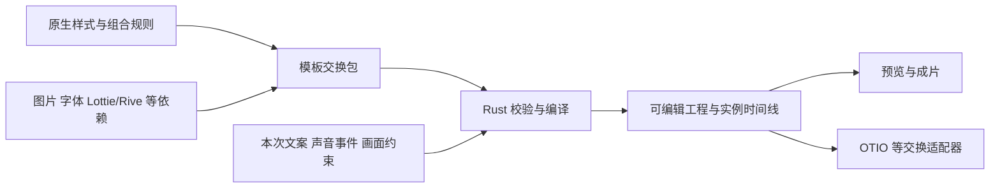

# 模板文件协议与现有标准调研

调研日期：2026-10-15。通过 Google 检索并阅读官方文档；Rive 的 RML/AI 文档通过其官网提供的文档读取接口核实。本次是格式与架构调研，没有运行第三方编译器、验证格式互转或实现 `.mot`。

## 结论

把视觉模板保存成可编辑、可复用文件，已有成熟先例。Adobe MOGRT 和 Apple Motion 最接近产品形态；dotLottie 最适合参考依赖封装；Rive 的 RML + CLI 最贴近“人和 AI 共用同一模型”；Creatomate 证明了编辑器与自动化渲染共用声明式 JSON 的路线。

本次查阅的格式中，没有一个直接覆盖我们完整的“声音/语义事件 → 重点词与字幕规则 → 画面约束 → 动效组合 → 可编辑成片”契约。这是对已查资料的范围判断，不是声称行业不存在其他方案。

建议保留一个薄的 Moirai 模板封装：内部沿用 Rust 的 `Definition` / `Template`，结构验证使用 JSON Schema；已有动画格式作为有明确能力边界的素材接入；OTIO 用于编排完成后的剪辑交换。无需为文件扩展名再建立一套本体。

## 已有方案与标准层次

| 方案 | 官方资料确认的能力 | 格式性质及边界 | 对我们的价值 |
| --- | --- | --- | --- |
| [Adobe MOGRT][s1] | 动效、源图像/视频/预合成、作者公开的编辑控件、预览；在 Premiere 修改公开属性 | Adobe 产品格式；本次未获得可供独立执行完整 AE 设计的通用互操作规范 | 模板作者与模板使用者分层；公开控件指向真实属性 |
| [Apple Motion 模板][s3] | 效果、转场、字幕、发生器；可发布参数、子参数、滤镜/行为开关、绑定控件和屏幕控制 | Motion / Final Cut 产品生态的模板机制 | 参数分组、公开范围、一个控件组合多个底层参数 |
| [Lottie JSON][s4] | JSON 表达图层、属性动画、资源、markers、slots | 社区公开规范；首页仍说明标准化持续推进，已核对页面提供 `1.0.1 (latest)` 版本 | 插画、icon、局部文字动效的交换与渲染候选 |
| [dotLottie `.lottie`][s6] | ZIP + manifest，包含 Lottie 动画、图片、字体、主题、状态机 | 开源封装规范；其内层内容有 Lottie 语义要求，并非任意视频文档通用 ZIP | 单文件依赖封装、主题、版本和初始入口 |
| [Rive `.rml` / `.riv`][s7] | RML 用 XML 表达场景和关系；CLI 编译为运行用 `.riv` 或编辑器用 `.rev`；类型查询、检查、截图 | 官方公开描述的 Rive 格式及工具链；不是跨剪辑器的视频模板标准 | AI 与编辑器同模型、源码与运行产物分离、检查与视觉验证闭环 |
| [OpenTimelineIO][s10] | clips、tracks、timing、transitions、markers、metadata；媒体引用；另有 `.otioz` 打包 | 开放剪辑交换格式；效果对画面的具体影响由应用定义 | 已生成时间线的交换，而非重点词样式规则的主体 |
| [Creatomate RenderScript][s13] | 编辑器生成 JSON，也可直接按 JSON 渲染视频/图像；模板允许参数替换和插入元素 | 厂商的数据格式和 API 契约；不能据此认为其他引擎可直接执行 | 同一份声明式数据服务编辑器、API 与批量生成 |
| [JSON Schema 2020-12][s15] | 描述 JSON 结构、类型、引用与校验规则 | 通用数据描述规范，不定义视频视觉语义 | 从 Rust 生成结构契约，供 UI、AI 与验证器使用 |

“有公开文档”“有开源实现”“是社区规范”“能跨引擎无损交换”是不同承诺。采用相同的 JSON 或 ZIP，并不会自动获得动画效果兼容性。

## 对设计影响最大的发现

### 公开参数应直接绑定原生属性

Adobe 明确说明：只有作者放入 Essential Graphics 面板的控件，才开放给 Premiere 用户调整；控件与源属性关联。它支持分组、说明、字体选项、数据驱动控件和媒体替换。[s1]

Apple 同样允许公开一个参数、某个子参数或绑定控件。其文档甚至区分了“画布屏幕控制”与“检查器数值控制”：发布前者不会自动发布后者。[s3]

对 Moirai 的设计建议：

- 模板源文档保留完整设计；应用面板只呈现作者明确公开的输入与控件。
- 控件使用稳定 ID，声明类型、默认值、范围、单位、分组及绑定目标。绑定应定位稳定对象/属性，不依赖数组中的第几个图层。
- 控件不另存一份互相漂移的样式值。修改控件通过 Rust 更新同一原生属性；单次套用值属于 Application。
- 参数对外公开不代表整个内层动画已经转换为原生可编辑图层。

本次核对的 `Definition.inputs` 是 `TextInput`，含 `id`、`label`、`default`、`maxCharacters`、`layerIds`。它提供了文字输入基础，不能仅凭此宣称已有覆盖颜色、开关、枚举、素材等类型的完整模板公开参数协议。通用控件应在原生模型中设计，不塞进 ZIP 清单成为另一套业务模型。

### 模板有局部动画时间，应用才有实际成片时间

Adobe Responsive Design - Time 支持保护入场、退场或任意区段：调整模板总长度时，保护区时长不变，未保护区伸缩。官方也列出含音频的模板在 Premiere 中不能按同样方式自适应伸缩的限制。[s2]

Lottie 的动画对象明确有 `fr`、`ip`、`op`，也有命名片段 `markers`。[s5] 因此，“模板由 TTS 动态驱动”不需要否定局部关键帧，而是需要区分两个时间域：

| 时间域 | 归属 | 示例 |
| --- | --- | --- |
| 局部设计时间 | 样式/动效定义 | 弹入耗时、循环片段、退场曲线、可伸缩保持区 |
| 本次事件时间 | 输入/Application/编译结果 | 重点词从 3.2 秒读到 3.8 秒，具体画面事件在 4.1 秒发生 |

应明确入场/保持/退场如何映射到事件窗口；窗口过短时，是缩短哪一段、改变播放速率、延长可读保持，还是返回无法满足约束。循环必须有结束条件。上述都是需形成执行契约的规则，不能由某个模板临时挪关键帧代替。

时间伸缩的“保护区”与画面避让的“空间保护区”含义不同，不应复用一个无类型字段。

### Rive 已经提供与我们的 AI 目标非常接近的工作流

RML 官方文档确认：[s7]

- RML 是 XML；元素是 Rive 类型，属性是该类型的属性，嵌套表达对象关系。它复用编辑器模型。
- 一个或多个 `.rml` 文件可以编译成 `.riv`，也可以编译成可继续在 Rive Editor 编辑的 `.rev`。
- 文档明确列出 `rive schema` 的类型查询、可动画属性查询和可绑定属性查询。
- 检查分为编译、结构检查和渲染截图，明确说明干净的构建不能证明外观或行为正确。

官方 AI 文档还展示了 agent 编辑文本文件、实时预览、查询字段、编译和检查的流程。[s8] 这说明“让 AI 懂模板”不需要只有 AI 才能理解的隐藏 DSL。

对 Moirai，优先补齐原生 schema、属性能力、结构化诊断和可复现预览入口。RML 可列为外部动效源的候选，先用一个带可变文字/颜色的实际素材验证它是否适合；不能把“有文档”写成“已能无损导入”。本次未安装或执行 Rive CLI，也未评估其授权条件。

`.riv` 则是运行用二进制格式，官方记录了主次版本与属性类型表。其兼容策略允许部分未知特性成为 no-op。[s9] 我们的质量要求更严格：必需效果不支持时应报出不兼容；可选降级必须在预览与导入结果中可见。

### dotLottie 的包装方式可借鉴，语义不能随意替换

核对到的 v2 规范定义 `.lottie` 为 Deflate ZIP，必需 `manifest.json` 与 `a/` 动画目录，可选 `i/` 图片、`f/` 字体、`t/` 主题、`s/` 状态机。有效文件至少含一个符合 Lottie 规范的动画。[s6]

主题通过 slot ID 绑定可替换属性；状态机提供事件、条件和动作。它已不只是“压缩后的动画 JSON”。但把 Moirai 的 `Template` 放入同样的目录，并不能使其成为 dotLottie。

我们的封装可以学习“清单 + 原生设计 + 依赖 + 预览”，在依赖中保留外部 `.lottie` 文件；外层仍由 Moirai 描述声音事件、语义调度和画面约束。是否能离线使用还取决于资源是否实际打包，不能只检查扩展名。

### OTIO 的转场关系值得参考，但不能负责所有视觉效果

OTIO 把 Transition 放在同一轨道的两个相邻对象之间，并用 `in_offset` / `out_offset` 表达两侧占用范围。转场不增加或缩短整条轨道时长。[s11] 这与“转场描述前后两方关系”相符，也说明它和单元素入场动画需要分别建模。

官方明确说明：片段效果如何改变画面是应用特定行为。其文件包 `.otioz` 另将 `content.otio`、`version.txt` 和媒体放入 ZIP；普通 `.otio` 主要保存外部媒体引用。[s10][s12]

建议将 OTIO 作为编译后时间线的导出候选。复杂字幕、花字、滤镜等无法用目标格式无损表达时，需要明确列出损失；若烘焙成视频能保留视觉，则应标记元素编辑性已丢失。

### 声明式源格式可以同时服务编辑器与自动化

Creatomate 明确将 RenderScript 定义为视频/图像的 JSON 源数据；模板编辑器会自动生成这份数据，也可直接按 JSON 渲染。其示例包含文字、音频、视频、嵌套 composition、动画和模板 modifications。[s13][s14]

这支持我们现有的方向：UI 编辑与 AI 编辑共享原生文档，而非从 UI 另外导出一套不完整协议。它并不意味着必须照搬其字段或转场模型；我们仍需要自己的声音驱动和约束语义。

## 对 `.mot` 草案的具体建议

图中的外部格式适配属于建议方向，不表示当前已支持。

| 层次 | 建议采用 | 必须保持的边界 |
| --- | --- | --- |
| 原生设计 | 现有 Rust `Definition` / `Template` | 一个事实来源；效果、作用目标、关系与约束沿用原生模型 |
| 公开输入 | 在原生模型上补齐类型化参数绑定 | UI 与 AI 使用同一语义，单次值属于 Application |
| 文件封装 | ZIP + manifest + 原生 JSON + 依赖 | 清单负责身份、版本、依赖与能力，不负责新增业务规则 |
| 外部动效 | 按具体播放器/版本验证 Lottie、dotLottie、Rive 等 | 区分完整源编辑、公开参数编辑、仅播放；保留转换损失说明 |
| 实际调度 | 本次内容事件输入 Rust 编译器 | 不把某次 TTS 的真实词时间、场景 ID 和人脸框写进可复用样式 |
| 剪辑交换 | 编译后 OTIO 适配 | 不以时间线交换格式承载所有模板审美和适配规则 |
| 校验 | Rust 生成的 JSON Schema + 语义/能力校验 + 预览 | 合法、可执行、视觉合格分别给出结果 |

JSON Schema 2020-12 可作为新封装 schema 的候选方言；实施时需核对当前 `schemars` 输出及验证库支持，不能仅修改 `$schema` 声明。效果目标是否合法、引用是否存在、时长约束能否满足、画面是否遮挡，仍需 Rust 语义校验或实际渲染检查。

第一版优先支持原生格式的无损往返。外部动效建议先选一种明确的可执行子集，验证内容替换、字体、seek、时长映射、透明合成和导出一致性，再公布对应能力。一个格式的播放器能运行，不等于我们的元素编辑器能展开它的全部图层。

## 命名与尚未验证的部分

`.mot` 已有其他用途：[OpenSim 官方文档][s16] 将它定义为 SIMM/OpenSim 使用的 motion 数据格式，含文件头和随时间变化的数据。它不是现有视频模板通用标准。

这不妨碍内部继续使用 `.mot`，但它应保持暂定扩展名。识别必须依赖明确的 `format: "moirai.mot"` 和封装版本，不能仅凭后缀；发布前再确定产品文件关联。这里没有完成商标或全球扩展名唯一性调查。

仍待实施验证：

1. 原生模板导出、换机器导入、重新渲染，设计与依赖不丢失。
2. 同一模板换短词、长词和不同语速，局部动效规则不变，实例按事件重算。
3. 公开参数面板与 AI 改动都写入同一原生属性；保存后重开结果一致。
4. 不支持的必需能力和缺失依赖被明确拒绝或标记；不能静默消失后仍显示成功。
5. 接入某种外部动画时分别证明播放、参数编辑、源图层编辑的实际能力；明确预览与视频导出是否一致。

相关本地文件：[`mot-format-v1-proposal.md`](mot-format-v1-proposal.md)。原生模型核对范围：`rust/crates/footage/src/templates/{model,dynamic_asset,ontology,api}.rs`。

## 官方来源

- [S1：Adobe — Work with Motion Graphics templates][s1]
- [S2：Adobe — Responsive Design][s2]
- [S3：Apple — 将控制从 Motion 发布到 Final Cut Pro][s3]
- [S4：Lottie — 官方规范首页与状态说明][s4]
- [S5：Lottie — Animation / Composition 字段][s5]
- [S6：dotLottie — v2.0 Specification][s6]
- [S7：Rive — Rive Markup Language][s7]
- [S8：Rive — Working with AI Agents][s8]
- [S9：Rive — .riv File Format][s9]
- [S10：OpenTimelineIO — Overview][s10]
- [S11：OpenTimelineIO — Timeline Structure][s11]
- [S12：OpenTimelineIO — File Bundles][s12]
- [S13：Creatomate — What is RenderScript?][s13]
- [S14：Creatomate — Create a video by RenderScript][s14]
- [S15：JSON Schema — Draft 2020-12][s15]
- [S16：OpenSim — Motion (.mot) Files][s16]

[s1]: https://helpx.adobe.com/after-effects/desktop/motion-graphics/work-with-motion-graphics-templates/creating-motion-graphics-templates.html
[s2]: https://helpx.adobe.com/after-effects/desktop/motion-graphics/add-responsive-design/responsive-design.html
[s3]: https://support.apple.com/zh-cn/guide/motion/motna47583a5/mac
[s4]: https://lottie.github.io/lottie-spec/latest/
[s5]: https://lottie.github.io/lottie-spec/latest/specs/composition/#animation
[s6]: https://dotlottie.io/spec/2.0/
[s7]: https://rive.app/docs/runtimes/advanced-topic/rml
[s8]: https://rive.app/docs/cli/agents
[s9]: https://rive.app/docs/runtimes/advanced-topic/format
[s10]: https://opentimelineio.readthedocs.io/en/latest/
[s11]: https://opentimelineio.readthedocs.io/en/latest/tutorials/otio-timeline-structure.html
[s12]: https://opentimelineio.readthedocs.io/en/latest/tutorials/otio-filebundles.html
[s13]: https://creatomate.com/docs/fundamentals/getting-started/what-is-render-script
[s14]: https://creatomate.com/docs/api/quick-start/create-a-video-by-render-script
[s15]: https://json-schema.org/draft/2020-12
[s16]: https://opensimconfluence.atlassian.net/wiki/spaces/OpenSim/pages/53089415/Motion+.mot+Files
